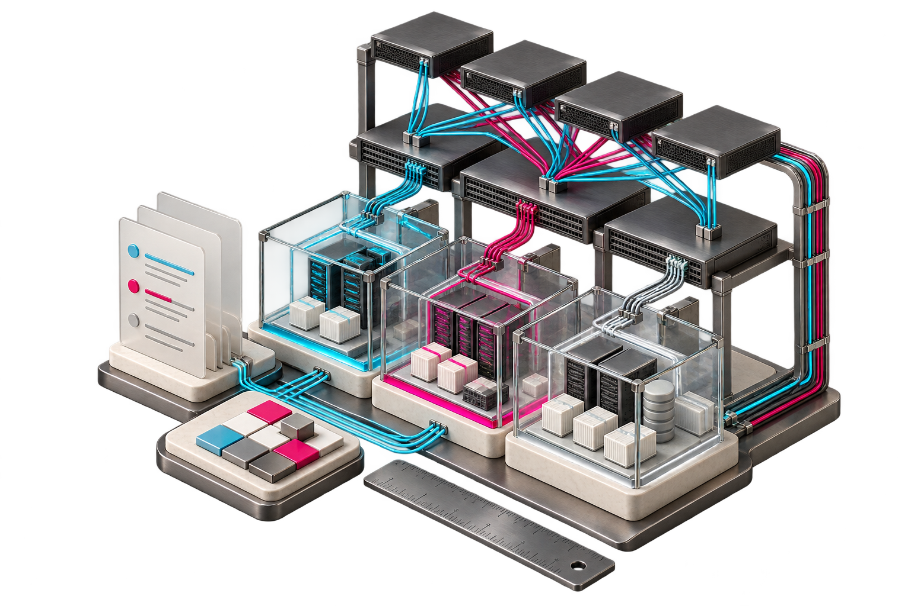

# Concept illustrations

These AI-generated editorial illustrations were prepared for Carlos Alvarado's public-project portfolio. They visualize the project's theme; they are not screenshots, architecture specifications, observed lab topology or validation evidence.

Use the executable examples and validation record to assess actual functionality. The detailed implementation covers one tenant per input, even where the illustration suggests several policy spaces.
