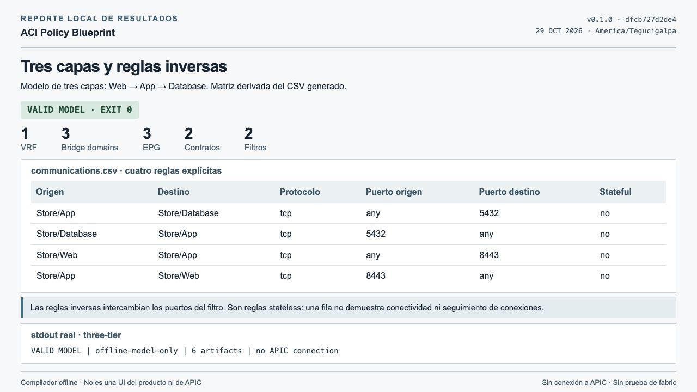
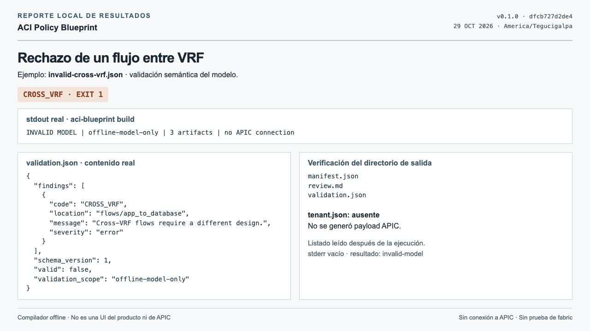
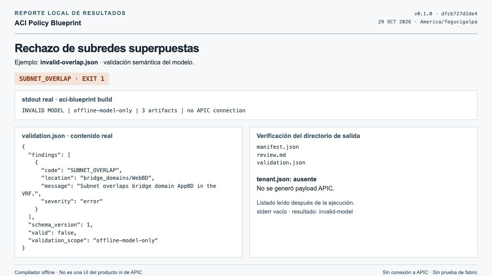
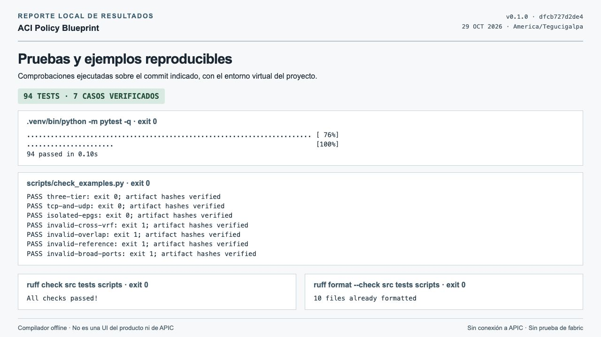
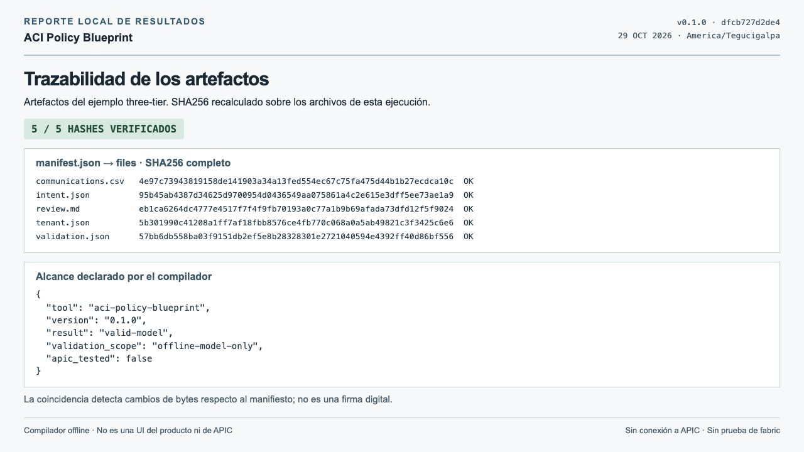

# Test capture gallery

Captured **2026-10-29**, America/Tegucigalpa, using v0.1.0 source commit [`dfcb727`](https://github.com/carlosalpo/aci-policy-blueprint/commit/dfcb727d2de41ca9ee4a362613a3836c67d3a445).

These are real browser captures of static local reports populated from executed commands and generated artifacts. They are **not the product's UI, APIC screenshots or fabric test evidence**. Every image states the offline scope. Names and addresses are synthetic; no client data is included.

The underlying runs passed 94 tests, Ruff lint/format and seven CLI scenarios. Negative examples correctly return exit 1 and contain no `tenant.json`. Source code and examples were compared byte for byte with the cited commit. [Provenance manifest](manifest.json), [commands and original output](runs/20261029-capture-02/), [source verification](source-verification.json), [privacy review](privacy-review.json) and [SHA-256 inventory](SHA256SUMS.txt) are included.

## Three-tier design and reverse-port rules

The generated matrix includes Web → App TCP 8443, App → Database TCP 5432 and their reverse-port rules. All rules are stateless. This matrix describes filter intent, not observed connectivity.

## Rejecting a cross-VRF flow

The invalid cross-VRF model returns exit 1. Its output contains only findings, a review and a manifest; no APIC payload is generated.

## Rejecting overlapping subnets

Overlapping bridge-domain subnets inside one VRF are rejected before policy generation.

## Reproducible tests and examples

Real local stdout from the installed package: 94 passing tests, seven verified examples, successful lint and formatting. [CI also passed on three Python versions](https://github.com/carlosalpo/aci-policy-blueprint/actions/runs/40935836140).

## Artifact traceability

All five artifacts referenced by the three-tier manifest match their SHA-256 digests. Hash consistency is not a digital signature or APIC validation.

## Reuse and reproduction

For the portfolio, images **01 and 02** show the primary output and a rejected design. Image 04 is an alternative when the emphasis is automated verification. Preserve the scope caption when reusing any capture.

The [HTML sources](views/) contain the captured report layouts. Commands in the package use paths relative to the original repository; replace output locations with a **new** local directory when reproducing. See the root README for installation and the seven-case checker. The [capture notes](README.txt) explain source selection and the excluded temporary/failed-run files.
